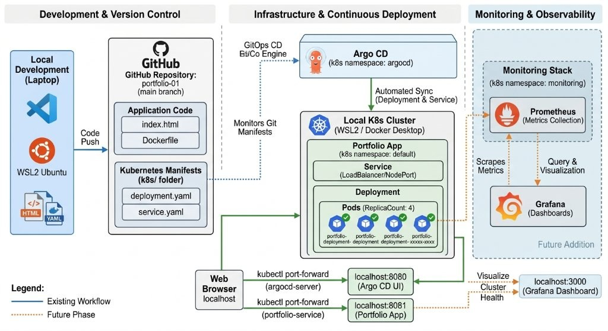

# End-to-End GitOps CD Pipeline with Kubernetes & Argo CD

A hands-on lab that removes manual `kubectl apply` from the release path. Git is the single source
of truth: a commit that changes pod density is detected by **Argo CD** and reconciled into a running
**Kubernetes** cluster — no operator in the loop.

**Live case study →** https://heinsitt.github.io/End-to-End-GitOps-CD-Pipeline-with-Kubernetes-Argo-CD/

---

## Architecture



Three cooperating planes:

| Plane | Responsibility | Components |
| --- | --- | --- |
| **01 · Authoring & version control** | Source and manifests are versioned together, so intent and change are one atomic commit | VS Code · Ubuntu (WSL2) · `index.html` · `Dockerfile` · `k8s/` |
| **02 · GitOps reconciliation** | Argo CD diffs desired state against live state and applies the delta automatically | Argo CD v3.5.6 · auto-sync · self-heal |
| **03 · Runtime & observability** | Workload runs on a local cluster; metrics are the explicitly scoped next phase | Docker Desktop Kubernetes · NodePort service · *Prometheus + Grafana (planned)* |

---

## Stack

| Layer | Tool |
| --- | --- |
| Build & runtime | Docker |
| Registry | Docker Hub — `heinsitt/portfolio:latest` |
| Orchestration | Kubernetes (Docker Desktop) |
| GitOps CD | Argo CD v3.5.6 |
| Source of truth | GitHub — `portfolio-01` |
| Dev environment | Ubuntu on WSL2 |
| Web server | `nginx:alpine` |

---

## Application

```dockerfile
FROM nginx:alpine
COPY ./ /usr/share/nginx/html
```

```bash
docker build -t heinsitt/portfolio:latest .
docker push heinsitt/portfolio:latest
```

## Kubernetes manifests

`k8s/deployment.yaml`

```yaml
apiVersion: apps/v1
kind: Deployment
metadata:
  name: portfolio-deployment
spec:
  replicas: 4
  selector:
    matchLabels:
      app: portfolio
  template:
    metadata:
      labels:
        app: portfolio
    spec:
      containers:
      - name: portfolio
        image: heinsitt/portfolio:latest
        ports:
        - containerPort: 80
```

`k8s/service.yaml` exposes the replica set as a `NodePort` service.

---

## GitOps workflow

1. **Build** — the static site is baked into an `nginx:alpine` image.
2. **Publish** — image layers go to Docker Hub; the manifest change is committed to `portfolio-01`.
3. **Detect** — Argo CD compares Git against the cluster, reports `OutOfSync`, then applies the difference.
4. **Enforce** — the ReplicaSet maintains the declared pod count and replaces deleted pods automatically.

---

## Verification

### Post-sync cluster state

```console
$ kubectl get deployment
NAME                   READY   UP-TO-DATE   AVAILABLE
portfolio-deployment   4/4     4            4

$ kubectl get pods
NAME                                     READY   STATUS
portfolio-deployment-59cff89f5-9fgr2     1/1     Running
portfolio-deployment-59cff89f5-fh2bb     1/1     Running
portfolio-deployment-59cff89f5-gwzsb     1/1     Running
portfolio-deployment-59cff89f5-x7kgj     1/1     Running
```

### Service exposure

```console
$ kubectl get svc
NAME                TYPE        CLUSTER-IP     PORT(S)
kubernetes          ClusterIP   10.96.0.1      443/TCP
portfolio-service   NodePort    10.96.90.246   80:32284/TCP

$ kubectl port-forward svc/portfolio-service 8081:80
Forwarding from 127.0.0.1:8081 -> 80
Forwarding from [::1]:8081 -> 80
Handling connection for 8081
```

### Milestones

| Screenshot | What it proves |
| --- | --- |
| `images/argocd-applications.png` | `portfolio-app` reports **Healthy** and **Synced** in Argo CD |
| `images/argocd-tree-view.png` | Service → Deployment → pod lineage with per-pod health |
| `images/argocd-4-pods.png` | Four healthy pods after the scale-out commit |
| `images/deployment-manifest.png` | The one-line `replicas: 4` change that triggered delivery |
| `images/scaling-2-to-4.png` | Two new pods appear with no manual rollout |
| `images/kubectl-pods-svc.png` | Pod and NodePort service state |
| `images/kubectl-port-forward.png` | Port-forward binding used for browser verification |
| `images/docker-push.png` | Image layers published to Docker Hub |
| `images/k8s-manifests.png` | Manifests versioned in Git alongside source |
| `images/live-app.jpg` | The containerised site rendering inside the cluster |

---

## Scope & honest limitations

This lab runs on a **local single-node cluster** (Docker Desktop Kubernetes).

- Port-forwarding is a verification mechanism here, **not** a production ingress strategy.
  A LoadBalancer controller or Ingress is the correct next step for public exposure.
- Argo CD polls the repository; the detection window is therefore bounded by the polling interval
  unless a Git webhook is configured.
- The monitoring plane (Prometheus + Grafana) is designed but **not yet implemented** — it is
  deliberately marked as the next phase rather than claimed as complete.

## Next phase

- [ ] Prometheus metrics collection in the cluster
- [ ] Grafana dashboards for pod and node health
- [ ] Alerting rules on replica and restart anomalies
- [ ] Ingress controller replacing port-forward

---

## Repository layout

```
.
├── index.html          # Case-study page (design-system based)
├── assets/
│   ├── css/
│   │   ├── tokens.css      # Design tokens: color, type, space, radius, motion
│   │   └── components.css  # Component layer built on the tokens
│   └── js/
│       └── app.js          # Theme, reveal, filters, lightbox, copy-to-clipboard
├── images/             # Lab evidence screenshots
└── README.md
```

---

**Hein Sitt Tun** — DevOps Engineering · [GitHub](https://github.com/heinsitt) · [LinkedIn](https://www.linkedin.com/in/heinsitttun/)
